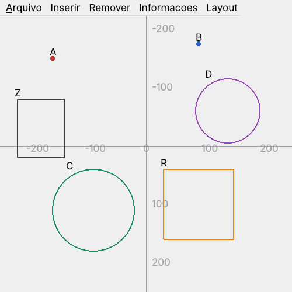

# Geometria 2D em C++ com Qt

Aplicação desktop para desenhar e manipular objetos geométricos 2D (pontos, círculos e retângulos), desenvolvida em **C++ com Qt 5** em 2018, como trabalho em equipe da disciplina de Fundamentos de Programação Orientada a Objetos, do curso de Engenharia Eletrônica da UTFPR.

> **English:** desktop application written in C++ with Qt 5 (2018, team project for the Object-Oriented Programming course at UTFPR) to draw 2D shapes, compute distances and areas, and save/load drawings to a file.



## Funcionalidades

- **Inserir** pontos, círculos e retângulos, com nome, coordenadas e cor
- **Remover** qualquer objeto pelo nome
- **Calcular distância** entre dois pontos ou entre um ponto e um círculo (zero se o ponto estiver dentro do círculo)
- **Calcular área** de círculos e retângulos
- **Salvar e abrir** os desenhos em arquivo de texto
- Validação de nomes, sem permitir nome em branco ou repetido, com mensagens de erro
- Recursos extras: **zoom** (Ctrl + e Ctrl −), **deslocamento da origem**, eixos com escala, escolha de **cor** de cada objeto e atalho para novo desenho

## Conceitos de orientação a objetos aplicados

| Conceito | Onde aparece |
|---|---|
| Classe abstrata e método virtual puro | `GEO`, com `virtual void Area() = 0` |
| Herança | `Circulo` e `Retang` herdam de `GEO` |
| Sobrescrita | `Area()` implementada em cada forma |
| Sobrecarga | `Ponto::getDist(Ponto*)` e `Ponto::getDist(Circulo*)`, além dos construtores |
| Exceções | Validação de nomes com `throw` e `try/catch` em `Janela.cpp` |
| Alocação dinâmica | Objetos criados com `new` |
| Estrutura de dados da STL | `std::map` indexando cada tipo de objeto pelo nome |

## Como compilar

Requer **Qt 5** e o **Qt Creator** (ou `qmake`).

**Pelo Qt Creator.** Abra o arquivo `APS.pro` e clique em *Run*.

**Pelo terminal.**
```bash
qmake APS.pro
make
./menus
```

## Organização do código

| Arquivo | O que faz |
|---|---|
| `main.cpp` | Cria a aplicação e abre a janela principal |
| `geo.h` / `geo.cpp` | Classes das formas geométricas, cálculos de área e distância |
| `Janela.h` / `Janela.cpp` | Janela principal, menus, desenho na tela, inserção, remoção e arquivos |
| `APS.pro` | Arquivo de projeto do Qt |

## O que eu faria diferente hoje

O código está como foi entregue em 2018, com uma única correção: a altura dos retângulos era desenhada com a coordenada errada (`getY2() - getX()` no lugar de `getY2() - getY()`). Olhando com a experiência de hoje, eu mudaria estes pontos.

- **Separar modelo e interface.** As formas herdam de `QWidget` e abrem as próprias janelas de cadastro no construtor. Eu deixaria as classes geométricas independentes do Qt e criaria os diálogos na interface.
- **`Ponto` fora da hierarquia.** `Ponto` repete atributos de `GEO` em vez de herdar dela.
- **Memória.** Objetos removidos ou rejeitados na validação não são liberados. Hoje eu usaria `std::unique_ptr`.
- **Área do retângulo.** O cálculo pode dar negativo dependendo da ordem dos vértices. Faltou usar o valor absoluto.
- **Arquivos.** Salvar ou abrir sem escolher um arquivo faz o programa fechar, porque o retorno de `fopen` não é verificado. Eu usaria `QFile` e trataria o erro.
- **Código repetido.** A validação de nomes é idêntica nas três inserções e poderia virar uma única função.

---

Trabalho desenvolvido em equipe. Repositório mantido por **Isadora Fernanda Zappe Schmidt** · [LinkedIn](https://www.linkedin.com/in/isadora-fernanda)
